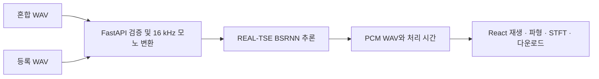

# 시스템 구조

브라우저가 혼합 및 등록 WAV를 FastAPI로 전송한다. SoundFile과 SciPy로 포맷을 검사하고 16 kHz 모노로 변환한다. 서버가 생성한 작업 ID로 처리 상태를 조회한다. REAL-TSE가 혼합 파형을 등록 음성의 WeSpeaker ECAPA 임베딩에 조건화하여 추정 파형을 반환한다. React는 두 PCM 파일을 재생하고 Canvas에 파형과 Web Worker에서 계산한 STFT를 그린다.

## HTTP API

| 방식 | 경로 | 내용 |
| --- | --- | --- |
| GET | `/api/v1/models` | 모델 ID, 버전, 샘플링 주파수, 체크포인트 및 예제 준비 상태 |
| POST | `/api/v1/mix` | multipart `a`, `b`를 혼합해 WAV 응답 |
| POST | `/api/v1/extract` | multipart `mixture`, `enrollment`를 접수하고 작업 ID를 202로 반환 |
| GET | `/api/v1/jobs/{id}` | `queued`, `processing`, `completed`, `failed` 상태 및 처리 시간 |
| GET | `/api/v1/jobs/{id}/result` | 추정 음성 PCM WAV |
| GET | `/api/v1/jobs/{id}/original` | 16 kHz 모노 비교 재생용 혼합 PCM WAV |
| GET | `/api/v1/examples/{name}` | 로컬에서 생성한 `mixed.wav`, `enroll.wav`, `enroll_b.wav` |

`processing_ms`는 대기열 통과 이후의 시간으로 모델 로딩과 인코딩을 포함한다. `inference_ms`는 모델이 파형을 처리하는 데 걸린 시간이다. 결과 비교는 같은 길이의 16 kHz 모노 WAV 두 개를 사용하며, 원본 다운로드 버튼은 브라우저에서 선택한 파일을 그대로 제공한다.

## 저장 및 실행

서버는 한 번에 최대 두 요청의 업로드를 읽으며 처리 중인 작업 포함 최대 네 작업을 실행 대기시킨다. 추론 작업은 한 개씩 별도 프로세스에서 처리하며 120초 후 종료된다. 작업별 임시 디렉터리에서 정규화한 입력과 중간 결과를 사용하고 완료 또는 실패 직후 제거한다. 최대 32개 작업의 상태 및 재생용 WAV를 메모리에 저장한다. 작업은 완료 15분 후 만료되며 정리 작업이 10초 간격으로 메모리에서 제거한다. 이 구성에서는 Uvicorn을 단일 워커로 실행한다. UUID를 아는 클라이언트가 결과에 접근할 수 있으므로 서버 기본 바인딩은 로컬 주소다. 화면에 내려받은 브라우저 Blob은 페이지가 사용 중인 동안 유지된다.

| 환경 변수 | 기본값 | 설명 |
| --- | --- | --- |
| `VOICEFOCUS_MODEL_DIR` | `.voicefocus/models/spk_emb_100` | 추론 시 사용할 REAL-TSE 체크포인트 디렉터리 |
| `VOICEFOCUS_DEVICE` | `cpu` | PyTorch 장치, CUDA 설치 환경에서는 `cuda` 사용 가능 |
| `VOICEFOCUS_TORCH_THREADS` | `2` | 모델 추론에 사용할 CPU 스레드 수 |
| `VOICEFOCUS_EXAMPLE_DIR` | `artifacts/synthetic/e02-full` | 웹에서 선택할 수 있는 세 예제 WAV의 디렉터리 |
| `VOICEFOCUS_CHECKPOINT_ARCHIVE` | 공식 다운로드 | 설치 시 재사용할 체크포인트 ZIP 경로 |

REAL-TSE BSRNN의 추론 코드는 입력·출력 상태를 청크 간 이어받는 API를 제공하지 않는다. 현재 구현의 오프라인 경로와 지연 측정은 [평가 결과](EVALUATION.md)에 기록했다.
