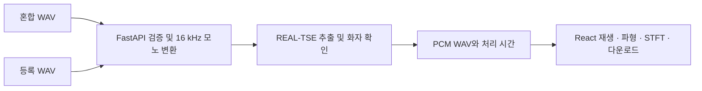

# 시스템 구조

브라우저가 혼합 및 등록 오디오를 FastAPI로 전송한다. SoundFile과 SciPy로 포맷을 검사하고 16 kHz 모노로 변환한다. 서버가 목표 화자 추출 작업을 등록한다. 브라우저는 작업 ID로 상태를 조회하고, React가 결과 PCM의 재생과 Canvas 파형 및 스펙트로그램을 제공한다.

## HTTP API

| 방식 | 경로 | 내용 |
| --- | --- | --- |
| GET | `/healthz` | HTTP 프로세스 상태 확인 |
| GET | `/api/v1/models` | 모델 및 예제 준비 상태, 파일 추출 가능 여부 `automatic_available`, 실시간 가능 여부 `live_available` |
| POST | `/api/v1/mix` | multipart `a`, `b`를 혼합해 WAV 응답 |
| POST | `/api/v1/extract` | multipart `mixture`, `enrollment` 접수 및 작업 ID 반환(202). 웹은 `mode=call`로 화자 검증을 적용한다. `speech`는 기본 모델, 기존 `auto`는 `call` 별칭이다. |
| GET | `/api/v1/jobs/{id}` | `queued`, `processing`, `completed`, `failed` 상태 및 처리 시간. 통화 녹음 결과가 완전히 음소거되면 `target_muted`가 참 |
| DELETE | `/api/v1/jobs/{id}` | 완료·실패 작업과 모든 음성 결과 삭제. 이미 없는 작업이면 204, 처리 중이면 409 |
| GET | `/api/v1/jobs/{id}/result` | 추정 음성 PCM WAV |
| GET | `/api/v1/jobs/{id}/original` | 16 kHz 모노 비교 재생용 혼합 PCM WAV |
| GET | `/api/v1/examples/{name}` | 로컬에서 생성한 `mixed.wav`, `enroll.wav`, `enroll_b.wav` |
| WebSocket | `/ws/v1/stream` | 등록 WAV를 최초로 받고 16 kHz 모노 little-endian Float32 PCM을 스트리밍 |
| WebSocket | `/ws/v1/calls` | `create` 또는 `join`으로 방 연결을 시작하고 두 브라우저 사이에서 SDP 교환 |

`processing_ms`는 대기열 통과 이후의 시간으로 모델 로딩과 인코딩을 포함한다. `inference_ms`는 모델이 파형을 처리하는 데 걸린 시간이다. 원본과 결과는 같은 길이의 16 kHz 모노 WAV다. 비교 재생기는 선택한 음성이 바뀌어도 위치를 유지하며, 원본 다운로드 버튼은 선택한 파일을 그대로 제공한다. 브라우저 마이크 녹음은 1–20초 등록 또는 최대 30초 혼합 WAV로 변환하며, 추출을 요청할 때 업로드한다.

통화 녹음 모드는 REAL-TSE 출력과 그 출력을 혼합 신호의 크기에 맞춰 뺀 잔차를 WeSpeaker 임베딩으로 비교한다. 제거 성분의 에너지가 혼합 에너지의 25% 이상일 때 잔차를 검증한다. 등록 음성은 원래 대역과 300–3400 Hz 전화 대역으로 각각 비교한다. 확인된 후보는 1.5초 문맥으로 250 ms마다 다시 검증하며, 거부된 블록은 0으로 출력한다. 이 경로는 녹음 파일 전체를 사용한다.

## 저장 및 실행

서버는 한 번에 최대 두 요청의 업로드를 읽으며 처리 중인 작업 포함 최대 네 작업을 실행 대기시킨다. 추론은 별도 프로세스에서 한 번에 한 작업을 처리한다. 시간 제한은 120초다. 작업별 임시 디렉터리에서 정규화한 입력과 중간 결과를 사용하고 완료 또는 실패 직후 제거한다. 최대 32개 작업의 상태 및 재생용 WAV를 메모리에 저장한다. 작업은 완료 15분 후 만료되며 정리 작업이 10초 간격으로 메모리에서 제거한다. 이 구성에서는 Uvicorn을 단일 워커로 실행한다. UUID를 아는 클라이언트가 결과에 접근할 수 있으므로 서버 기본 바인딩은 로컬 주소다. 화면에 내려받은 브라우저 Blob은 페이지가 사용 중인 동안 유지된다.

| 환경 변수 | 기본값 | 설명 |
| --- | --- | --- |
| `VOICEFOCUS_MODEL_DIR` | `.voicefocus/models/spk_emb_100` | 추론 시 사용할 REAL-TSE 체크포인트 디렉터리 |
| `VOICEFOCUS_DEVICE` | `cpu` | PyTorch 장치, CUDA 설치 환경에서는 `cuda` 사용 가능 |
| `VOICEFOCUS_TORCH_THREADS` | `2` | 모델 추론에 사용할 CPU 스레드 수 |
| `VOICEFOCUS_EXAMPLE_DIR` | `artifacts/synthetic/e02-full` | 웹에서 선택할 수 있는 세 예제 WAV의 디렉터리 |
| `VOICEFOCUS_CHECKPOINT_ARCHIVE` | 공식 다운로드 | 설치 시 재사용할 체크포인트 ZIP 경로 |

스트리밍 실험은 첫 연결에서 causal 모델 가중치를 읽어 같은 서버 프로세스에서 재사용한다. 등록 임베딩, STFT 입출력 겹침 샘플, 각 시간축 LSTM의 은닉 상태와 셀 상태는 세션마다 새로 계산한다. 창이 완성돼 파형이 확정된 구간을 반환하며, 마지막 청크에서 원래 입력 길이에 맞춰 남은 샘플을 출력한다. 지연과 품질 측정은 [평가 결과](EVALUATION.md)에 기록했다.

마이크 AudioWorklet은 2,048샘플(128 ms)마다 PCM을 보낸다. WebSocket은 등록 WAV를 검증한 뒤 `ready`를 보내고, 각 PCM 청크 처리 후 `processing_ms`를 응답한다. 검증을 통과한 후보 또는 무음은 별도의 바이너리 프레임으로 보낸다. 처음 1.25초는 전체 등록 WAV와 최대 세 개의 2초 구간을 원래 대역 및 전화 대역으로 비교한다. 유사도 0.30 이상이고 첫 출력 블록의 후보 에너지가 혼합 에너지의 4% 이상이면, 이후에도 아직 출력하지 않은 1.25초에 최대 1.25초의 이전 문맥을 붙여 0.625초 단위로 출력한다. 초기 근거가 약하면 세션 전체에 2.5초 순방향 검증 창과 0.75초 출력 단위를 사용한다. `end`를 받으면 남은 샘플을 처리하고 연결을 닫는다. 브라우저는 미처리 입력이 누적되면 마이크를 정지한다. 서버는 마이크 세션을 한 번에 하나 처리하고 오디오를 세션 메모리에 보관한다.

### 웹 통화 실험

같은 출처의 연결을 받아 12자리 방 코드를 발급한다. 두 번째 브라우저가 참가하면 호스트가 SDP offer를 보내고 참가자가 answer를 반환한다. SDP에는 브라우저가 수집한 직접 연결 후보가 포함된다. 방과 참가자는 서버 메모리에 두며 한 사람이 나가면 방을 닫고 상대에게 알린다. 실험은 직접 연결이 가능한 로컬 네트워크를 대상으로 한다.

마이크 음성은 WebRTC를 통해 상대 브라우저로 직접 전달된다. 수신자가 VoiceFocus를 켰을 때만 수신 음성과 상대 등록 WAV를 서버의 `/ws/v1/stream`에 보낸다. 마이크 실험과 같은 처리 경로를 사용하므로 서버 한 개당 동시 처리 세션은 하나다. 처리 중 원본은 음소거하며, 처리 연결이 끊긴 경우에도 사용자가 VoiceFocus를 끌 때까지 무음을 유지한다. 통화 지연을 평가할 때 화면에 표시되는 값은 상대 음성을 수신한 뒤의 필터 및 재생 대기 시간 추정치다.
