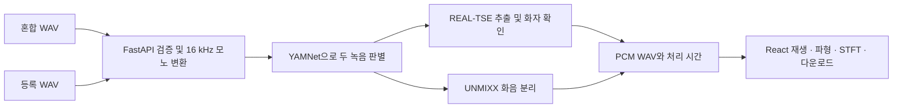

# 시스템 구조

브라우저가 혼합 및 등록 WAV를 FastAPI로 전송한다. SoundFile과 SciPy로 포맷을 검사하고 16 kHz 모노로 변환한다. 서버가 녹음의 종류를 판별해 작업을 한 개 등록한다. 브라우저는 작업 ID로 상태를 조회하고, React가 결과 PCM의 재생과 Canvas 파형 및 스펙트로그램을 제공한다.

## HTTP API

| 방식 | 경로 | 내용 |
| --- | --- | --- |
| GET | `/api/v1/models` | 모델, 예제 준비 상태와 자동 분리 가능 여부 `automatic_available`. 화음 모델의 `keep_enrollment_available`은 남길 가수 등록 지원 여부 |
| POST | `/api/v1/mix` | multipart `a`, `b`를 혼합해 WAV 응답 |
| POST | `/api/v1/extract` | multipart `mixture`, `enrollment`를 접수하고 작업 ID를 202로 반환. 웹은 `mode=auto`를 사용하며 판별에 따라 `call` 또는 `harmony` 작업을 한 개 생성. 화음에서는 선택 입력 `keep_enrollment` 사용 |
| GET | `/api/v1/jobs/{id}` | `queued`, `processing`, `completed`, `failed` 상태 및 처리 시간. 통화 녹음 결과가 완전히 음소거되면 `target_muted`가 참 |
| GET | `/api/v1/jobs/{id}/result` | 추정 음성 PCM WAV |
| GET | `/api/v1/jobs/{id}/residual` | 노래 화음 모드에서 지정한 가수의 목소리를 뺀 PCM WAV |
| GET | `/api/v1/jobs/{id}/original` | 16 kHz 모노 비교 재생용 혼합 PCM WAV |
| GET | `/api/v1/examples/{name}` | 로컬에서 생성한 `mixed.wav`, `enroll.wav`, `enroll_b.wav` |

`processing_ms`는 대기열 통과 이후의 시간으로 모델 로딩과 인코딩을 포함한다. `inference_ms`는 모델이 파형을 처리하는 데 걸린 시간이다. 원본과 결과는 같은 길이의 16 kHz 모노 WAV다. 비교 재생기는 선택한 음성이 바뀌어도 위치를 유지하며, 원본 다운로드 버튼은 선택한 파일을 그대로 제공한다. 브라우저 마이크 녹음은 1–20초 등록 WAV로 변환하며, 추출을 요청할 때 업로드한다.

자동 판별은 YAMNet의 노래 및 말소리 점수를 구간별로 모은다. 혼합 음성과 등록 음성 모두 말소리가 적고 노래가 감지된 경우 화음 모델을 사용한다. 대화와 통화에는 화자 확인을 적용한다. 레거시 API 호출은 기존 `speech`, `call`, `harmony` 값과 기본값 `speech`를 사용할 수 있다. [YAMNet](https://www.tensorflow.org/hub/tutorials/yamnet)

통화 녹음 모드는 REAL-TSE 출력과 그 출력을 혼합 신호의 크기에 맞춰 뺀 잔차를 WeSpeaker 임베딩으로 비교한다. 제거 성분의 에너지가 혼합 에너지의 25% 이상일 때 잔차를 검증한다. 등록 음성은 원래 대역과 300–3400 Hz 전화 대역으로 각각 비교한다. 확인된 후보는 1.5초 문맥으로 250 ms마다 다시 검증하며, 거부된 블록은 0으로 출력한다. 이 경로는 녹음 파일 전체를 사용한다.

노래 화음 모드에서는 UNMIXX가 두 후보를 분리하고 겹치는 구간의 파형 상관으로 순서를 맞춘다. 겹치는 구간이 조용하거나 파형 상관이 비슷하면 그 앞뒤의 음색을 비교해 같은 가수의 트랙을 잇는다. 후보 합이 원본 파형과 일치하도록 오차를 두 후보에 배분한다. Sony CSL 노래 음색 임베딩과 중앙 음높이를 등록 음성과 비교해 목표와 나머지를 선택한다. `keep_enrollment`를 함께 보내면 contrastive 및 VICReg 인코더를 사용하고, 두 등록 음성을 서로 다른 후보에 배정하는 두 조합의 점수를 비교한다. 두 점수가 가깝거나 구간 연결이 모호하면 `uncertain_match`로 표시한다. 사용자는 두 트랙을 듣고 제거 대상을 바꿀 수 있다.

## 저장 및 실행

서버는 한 번에 최대 두 요청의 업로드를 읽으며 처리 중인 작업 포함 최대 네 작업을 실행 대기시킨다. 추론은 별도 프로세스에서 한 번에 한 작업을 처리한다. 시간 제한은 일반 음성 120초, 노래 화음 240초다. 작업별 임시 디렉터리에서 정규화한 입력과 중간 결과를 사용하고 완료 또는 실패 직후 제거한다. 최대 32개 작업의 상태 및 재생용 WAV를 메모리에 저장한다. 작업은 완료 15분 후 만료되며 정리 작업이 10초 간격으로 메모리에서 제거한다. 이 구성에서는 Uvicorn을 단일 워커로 실행한다. UUID를 아는 클라이언트가 결과에 접근할 수 있으므로 서버 기본 바인딩은 로컬 주소다. 화면에 내려받은 브라우저 Blob은 페이지가 사용 중인 동안 유지된다.

| 환경 변수 | 기본값 | 설명 |
| --- | --- | --- |
| `VOICEFOCUS_MODEL_DIR` | `.voicefocus/models/spk_emb_100` | 추론 시 사용할 REAL-TSE 체크포인트 디렉터리 |
| `VOICEFOCUS_DEVICE` | `cpu` | PyTorch 장치, CUDA 설치 환경에서는 `cuda` 사용 가능 |
| `VOICEFOCUS_TORCH_THREADS` | `2` | 모델 추론에 사용할 CPU 스레드 수 |
| `VOICEFOCUS_EXAMPLE_DIR` | `artifacts/synthetic/e02-full` | 웹에서 선택할 수 있는 세 예제 WAV의 디렉터리 |
| `VOICEFOCUS_CHECKPOINT_ARCHIVE` | 공식 다운로드 | 설치 시 재사용할 체크포인트 ZIP 경로 |

스트리밍 실험은 causal 체크포인트의 등록 임베딩, STFT 입출력 겹침 샘플, 각 시간축 LSTM의 은닉 상태와 셀 상태를 세션별로 유지한다. 창이 완성돼 파형이 확정된 구간을 반환하며, 마지막 청크에서 원래 입력 길이에 맞춰 남은 샘플을 출력한다. 지연과 품질 측정은 [평가 결과](EVALUATION.md)에 기록했다.
