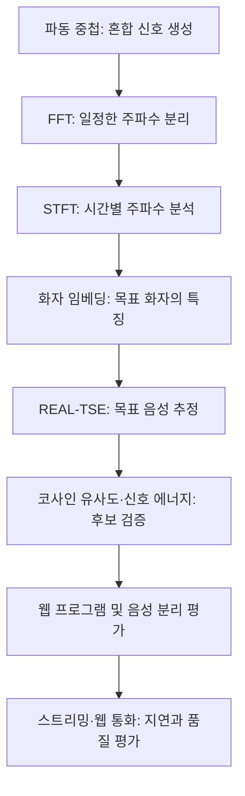

# VoiceFocus 연구 과정

> **연구 주제:** 파동의 중첩과 주파수 분석을 활용한 AI 목표 화자 추출  
> 연구 범위: 대화·통화 음성 | 2026년 11월

## 01. 연구 동기와 질문

여러 사람이 동시에 말하는 환경에서 통화 상대의 목소리만 듣고 싶다는 문제에서 출발했다. 마이크는 여러 음파가 중첩된 하나의 신호를 기록한다. 이 혼합 신호에서 목표 화자를 다시 추출할 수 있는지 단계적으로 탐구했다.

- 서로 다른 주파수의 파동은 주파수 분석으로 분리 가능한가?
- 주파수가 시간에 따라 변하거나 두 사람의 주파수 대역이 겹치면 어떻게 해야 하는가?
- 화자의 특징과 신호 에너지를 함께 사용하면 분리 오류를 줄일 수 있는가?
- 파일 추출을 실시간 웹 통화까지 확장할 수 있는가?

## 02. 연구 흐름

## 03. 물리·수학 원리 검증

혼합 파동은 이상적인 선형 중첩 조건에서 $y[n]=a[n]+b[n]$이다. 추가 정보 없이 이 식을 만족하는 두 파동을 유일하게 결정할 수 없으므로, 주파수라는 단서를 활용했다.

16 kHz, 1초, 진폭 0.4인 440 Hz·880 Hz 사인파를 생성해 FFT로 두 성분을 찾고 각 주파수의 복소 계수를 남겨 역 FFT로 복원했다. 두 사인파는 이 관측 구간에서 직교한다. 이후 2초 동안 200 Hz에서 1,800 Hz로 변하는 신호를 STFT로 분석했다. Hann 창 512샘플(32 ms), 이동 간격 128샘플(8 ms)을 사용했다.

**한계:** STFT는 주파수의 시간 변화는 보여주지만 같은 시간·주파수에서 겹치는 두 화자의 소속을 결정하지는 못한다.

[기초 파동·FFT·STFT 실험](experiments/01_DSP.md)

## 04. 화자 특징 분석

화자의 성대 및 성도 공명 특성에서 비롯되는 음성의 특징을 사전 학습된 화자 인코더로 벡터화했다. 등록 음성은 혼합에 사용하지 않은 독립 발화로 구성했다. 코사인 유사도는 두 벡터의 내적을 각 크기의 곱으로 나눈 값이다. 동일 화자와 다른 화자의 유사도 분포를 비교했다.

[화자 임베딩 실험](experiments/02_EMBEDDING.md)

## 05. 목표 화자 추출

REAL-TSE의 사전 학습된 BSRNN 기반 모델을 사용했다. 주파수 대역 및 시간적 특징과 등록 화자의 벡터를 조건으로 삼아 혼합 신호에서 목표 음성을 추정한다. 시간-주파수 마스킹은 그 원리를 설명하는 한 방법이며, 추정된 성분은 역변환으로 시간 영역 신호가 된다. 본 연구는 모델을 처음부터 학습한 것이 아니라 공개 체크포인트를 연결하고 평가·검증 방법을 구현한 것이다.

자연 음성(LibriSpeech)과 합성 음성(eSpeak NG)을 중첩하고, A/B의 별도 등록 음성으로 각각 추출했다. SI-SDR 개선량을 기준으로 비교하고 실패 조건도 기록했다.

[음성 분리 실험](experiments/03_TSE.md)

## 06. 에너지 기반 화자 검증

디지털 신호 에너지 $E_x=\sum_n x[n]^2$는 물리적 에너지(J) 자체가 아니라 파형의 상대적인 크기 지표이다.

$$E_y=E_a+E_b+2\sum_n a[n]b[n]$$

기본 모델이 다른 화자를 선택하거나 목표 화자가 침묵할 때 출력을 내는 문제를 확인했다. 혼합 $y$와 추정 음성 $\hat a$ 사이의 내적을 이용해 크기 보정 계수 $g$를 계산하고 잔차 $r=y-g\hat a$를 얻었다. 설명 에너지 비율이 충분할 때 잔차를 추가 후보로 비교하고 등록 화자와의 임베딩 유사도로 검증했다. 전화 대역(300–3400 Hz)에서도 비교하고, 1.5초 문맥에서 250 ms 단위로 재검증해 거부된 구간을 음소거했다.

[통화 모사 및 화자 검증 실험](experiments/04_CALL.md)

## 07. 실시간 구현과 개선

초기에는 각 청크를 독립적으로 추론했으나 품질과 지연이 나빴다. STFT 겹침 샘플과 LSTM 상태를 다음 청크로 넘겨 연속 처리하도록 개선했다. 브라우저 AudioWorklet과 WebSocket을 통해 128 ms PCM 청크를 보내며, 후보의 극성과 화자 일치 여부를 검증한다. 이후 초기 근거가 충분하면 1.25초부터 출력하고 아니면 더 긴 검증 문맥을 사용하는 방식으로 개선했다.

[독립 청크 및 상태 유지 실험](experiments/05_STREAMING.md) · [실시간 검증 창 실험](experiments/06_LIVE.md)

## 08. 서비스 구현

React/TypeScript UI, FastAPI, REAL-TSE, WeSpeaker, FFmpeg 및 WebRTC로 파일 추출·음성 혼합·자체 웹 통화를 연결했다. 독립 실시간 마이크 화면은 최종 서비스에서 제거했으며, 기존 실시간 연구 기록과 통화용 처리 경로는 유지했다. 혼합 음성 및 등록 음성은 파일 또는 마이크에서 입력한다. 비교 재생, 파형·스펙트로그램, WAV 다운로드를 제공한다.

[시스템 구조](ARCHITECTURE.md) · [최종 연구 결과](EVALUATION.md) · [실행 방법](../README.md)

## 09. 연구의 범위

모든 음성 실험은 제한된 공개 데이터·합성 음성 및 CPU 환경의 평가이다. 일반적인 실세계 화자와 전화망에서 성능이 보장되지 않는다. 100 ms 미만 목표는 달성하지 못했다. 기존 실험 측정값과 2026-11-27의 기초 DSP 재현 계산을 구별해 각 문서에 표기했다.
